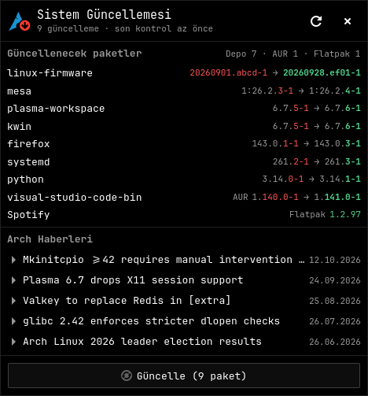
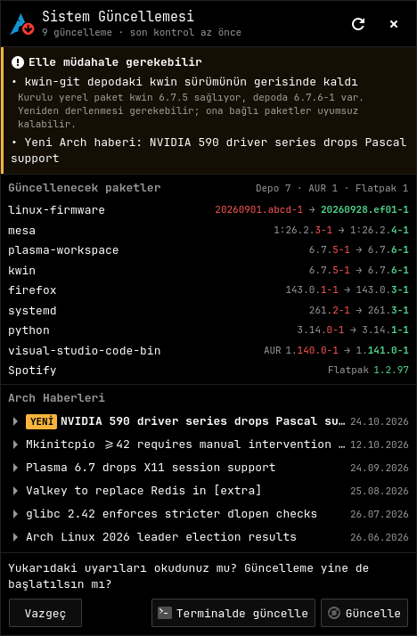
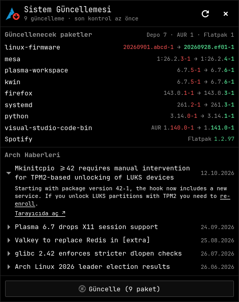
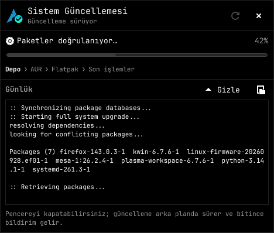
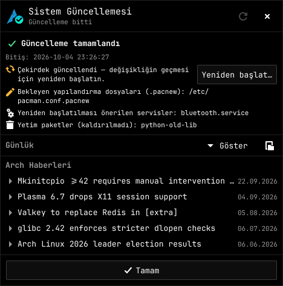

# arch-update-gui

[English](README.md) · **Türkçe**

KDE Plasma'da [cachy-update](https://github.com/CachyOS/cachy-update)
([arch-update](https://github.com/Antiz96/arch-update)'in CachyOS çatalı) için küçük bir
PySide6 + QML açılır penceresi. arch-update tepsi simgesine tıklayınca terminal yerine sağ üst
köşede, bir Plasma tepsi açılır penceresi gibi açılır.



> **Başlamadan önce küçük bir not:** arch-update-gui en başta kendi kullanımım için tasarlandı; başkalarının da işine yarayabilir diye paylaşıyorum. Kendi ihtiyaçlarım ve tercihlerim doğrultusunda şekillendiği için herkese hitap etmeyebilir. Öneri ve geri bildirimlerinizi memnuniyetle karşılarım.
>
> Bu yüzden bazı seçimler koda sabitlenmiştir: `cachy-update` bekler, AUR güncellemeleri için
> `yay`'i, terminal olarak `konsole`'u kullanır ve aşağıda anlatılan parolasız `sudo` kuralına
> ihtiyaç duyar.

> **Not:** arayüz metinleri şimdilik yalnızca Türkçe.

## Ne yapar

- Depolardan (`checkupdates`), AUR'dan (`yay -Qua`) ve Flatpak'tan bekleyen güncellemeleri
  listeler; her sürümün değişen kısmı vurgulanır.
- Son Arch Linux haberlerini gösterir; haberler yerinde açılıp okunabilir.
- Güncellemeyi tek düğmeyle başlatır. Yalnızca elle müdahale gerekebilecek durumlarda onay
  ister:
  - okunmamış bir Arch haberi varsa,
  - ayrı bir eşitleme veritabanına karşı yapılan `pacman -Sup` deneme çalıştırması başarısız
    olursa ya da bir soru soracak olursa,
  - bir depo paketinin yerini alan (onu hem sağlayan hem onunla çakışan) yerel olarak
    derlenmiş bir paket artık depodaki sürümden eskiyse.
- Güncellemeyi ayrı bir `systemd-run --user` biriminde çalıştırır; böylece açılır pencereyi
  kapatmak pacman'i yarıda kesmez. Pencere yeniden açıldığında süren güncellemeye bağlanır,
  ilerlemeyi ve günlüğü gösterir.
- Güncellemeden sonra yeniden başlatma gerekip gerekmediğini (çekirdek güncellendiyse),
  bekleyen `.pacnew` dosyalarını, yeniden başlatılması gereken servisleri (`checkservices`) ve
  sahipsiz paketleri bildirir; paket önbelleğini `arch-update.conf` içindeki
  `KeepOldPackages` / `KeepUninstalledPackages` değerleriyle `paccache` kullanarak temizler.
- arch-update'in durum dosyalarını (`~/.local/state/arch-update`) ve tepsi simgesini güncel
  tutar.

| Elle müdahale | Haberler | Güncelleniyor | Tamamlandı |
|---|---|---|---|
|  |  |  |  |

## Gereksinimler

- Wayland üzerinde KDE Plasma 6 çalışan Arch Linux (açılır pencere bir layer-shell yüzeyidir)
- `cachy-update` (`arch-update`'i, tepsisini ve burada kullanılan `cachy-update-*`
  simgelerini sağlar)
- Python 3, `pyside6`, `kirigami`, `qqc2-desktop-style`, `layer-shell-qt`
- `pacman-contrib` (`checkupdates`, `paccache`, `pacdiff`)
- `archlinux-contrib` (`checkservices`)
- `util-linux` (`script`, `flock`), `systemd` (`systemd-run`), `libnotify`
  (`notify-send`)
- İsteğe bağlı: AUR güncellemeleri için `yay`, `flatpak`, "terminalde güncelle" düğmesi için
  `konsole`, yeniden başlatma sorusu için `qt6-tools` (`qdbus6`)

CachyOS değişiklikleri olmayan özgün `arch-update` denenmedi; farklı simge adları kullanır.

### Parolasız sudo

Güncelleme terminal olmadan çalıştığı için `runner.sh`, `sudo -n` çağırır (hiçbir zaman parola
sormaz). Aşağıdaki komutlara parolasız izin verilmelidir; yoksa güncelleme hemen başarısız
olur:

```
pacman -Syu --noconfirm --color never
paccache -r ...
checkservices -F -P -R ...
```

Örnek `/etc/sudoers.d/arch-update-gui` (`visudo` ile düzenleyin, `youruser` yerine kendi
kullanıcı adınızı yazın):

```
youruser ALL=(root) NOPASSWD: /usr/bin/pacman -Syu --noconfirm --color never, /usr/bin/paccache, /usr/bin/checkservices
```

Bunun, kullanıcınızın tam sistem güncellemesini ve bu araçları root olarak parolasız
çalıştırabilmesi anlamına geldiğini unutmayın.

AUR paketleri `yay -Sua --noconfirm` ile derlenir; diff/clean/edit soruları "None" olarak
yanıtlanır.

## Kurulum

### Arch Linux (PKGBUILD)

```sh
git clone https://github.com/lckt0/arch-update-gui.git
cd arch-update-gui
makepkg -si
```

### Elle kurulum

```sh
git clone https://github.com/lckt0/arch-update-gui.git ~/.local/share/arch-update-gui
mkdir -p ~/.local/bin
ln -s ~/.local/share/arch-update-gui/arch_update_gui.py ~/.local/bin/arch-update-gui
```

### Tepsi simgesine bağlama

arch-update tepsisi `arch-update.desktop` dosyasını çalıştırır ve önce
`~/.local/share/applications` dizinine bakar. Tepsi simgesine tıklayınca açılır pencerenin
gelmesi için birlikte gelen masaüstü dosyasını oraya koyun:

```sh
mkdir -p ~/.local/share/applications
# paketle kurulum:
cp /usr/share/arch-update-gui/arch-update.desktop ~/.local/share/applications/
# elle kurulum:
cp ~/.local/share/arch-update-gui/arch-update.desktop ~/.local/share/applications/
```

Ardından [Parolasız sudo](#parolasız-sudo) bölümünde anlatılan `sudo` kuralını ekleyin.

## Kullanım

Tepsi simgesine tıklayın ya da `arch-update-gui` komutunu çalıştırın. Simgeye yeniden
tıklamak ya da Esc'ye basmak pencereyi kapatır. Aynı anda yalnızca bir pencere çalışır;
yeniden başlatmak var olanı öne getirir.

Tanıtım kipi sahte veri ve sahte bir çalıştırıcı kullanır, sisteme dokunmaz:

```sh
ARCH_UPDATE_GUI_DEMO=1 arch-update-gui
ARCH_UPDATE_GUI_DEMO=1 ARCH_UPDATE_GUI_DEMO_WARN=1 arch-update-gui   # uyarılarla
```

Dosyalar:

- `~/.local/state/arch-update-gui/run.log` – son güncellemenin günlüğü
- `~/.local/state/arch-update-gui/run.result` – son güncellemenin sonucu
- `~/.local/state/arch-update-gui/acks.json` – onaylanmış haberler ve uyarılar

## Kaldırma

### Arch Linux (paket)

```sh
sudo pacman -Rns arch-update-gui
```

### Elle kurulum

```sh
rm ~/.local/bin/arch-update-gui
rm -rf ~/.local/share/arch-update-gui
```

### Sistem değişikliklerini geri alma

Tepsi simgesinin arch-update'i yeniden terminalde açması için masaüstü dosyasını, eklediyseniz
`sudo` kuralını da kaldırın:

```sh
rm ~/.local/share/applications/arch-update.desktop
sudo rm /etc/sudoers.d/arch-update-gui
```

### Kullanıcı verileri (isteğe bağlı)

Güncelleme günlüğü, son sonuç ve onaylanmış haberler `~/.local/state/arch-update-gui`
dizininde tutulur:

```sh
rm -r ~/.local/state/arch-update-gui
```

`~/.local/state/arch-update` dizinine dokunmayın; o arch-update'in kendisine aittir.

## Lisans

MIT, ayrıntılar için [LICENSE](LICENSE).
